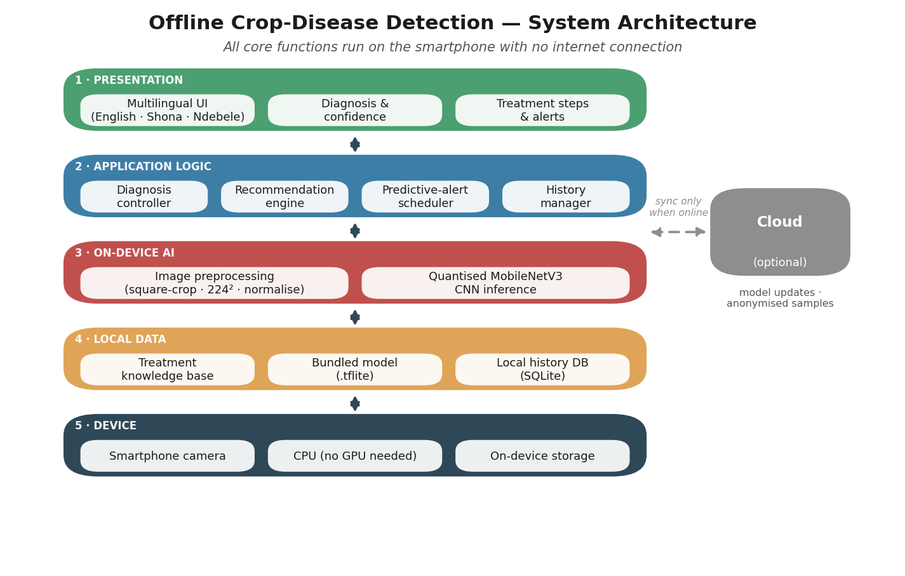
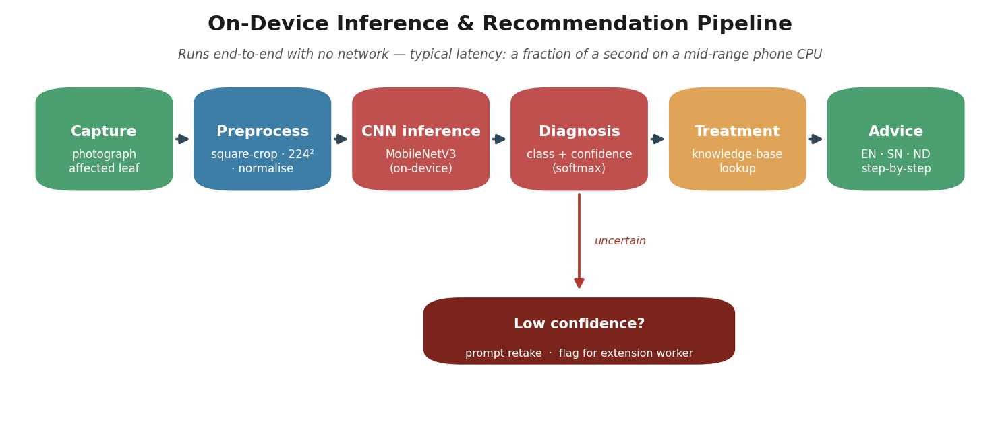
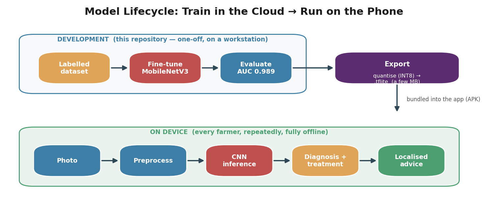

# Offline App Architecture

How the trained NCLB model is delivered to smallholder farmers as an **offline, on-device** smartphone application. The machine-learning engine is documented in [SUMMARY.md](SUMMARY.md); this document covers the surrounding system.

## Design goal: offline-first

Rural farming areas in Zimbabwe often lack reliable connectivity, so the application is built so that **every core function — capture, diagnosis, treatment advice — runs entirely on the phone**, with no server round-trip. Connectivity, when available, is used only opportunistically (model updates, optional anonymised data sharing). The model is small enough to ship inside the app and run on a modest phone CPU, which is what makes this possible.

---

## 1. System architecture

A layered design: each layer depends only on the one below it, and the whole stack sits on the device.

| Layer | Responsibility |
|---|---|
| **1 · Presentation** | Multilingual UI (**English · Shona · Ndebele**) showing the diagnosis with a confidence score, treatment steps, and alerts — designed for varied literacy levels. |
| **2 · Application logic** | Orchestration: a diagnosis controller, the recommendation engine (maps a diagnosis to treatments), a predictive-alert scheduler, and a history manager. |
| **3 · On-device AI** | Image preprocessing (square-crop → 224×224 → normalise) feeding the **quantised MobileNetV3 CNN** that performs inference locally. |
| **4 · Local data** | The treatment **knowledge base**, the bundled model file (`.tflite`), and a local **history database** (SQLite) — all stored on the device. |
| **5 · Device** | The phone itself: camera, CPU (no GPU required), and storage. |

The **cloud is optional** (dashed link): when the phone is online it can pull an updated model or contribute anonymised samples, but nothing on the diagnosis path requires it.

---

## 2. Inference & recommendation pipeline

What happens for a single photo, end-to-end, on the device:

1. **Capture** — the farmer photographs an affected leaf.
2. **Preprocess** — the image is square-cropped, resized to 224×224, and normalised (identical to training).
3. **CNN inference** — the on-device MobileNetV3 produces class scores.
4. **Diagnosis** — softmax gives the predicted class and a **confidence**.
5. **Treatment lookup** — the diagnosis keys into the local knowledge base for agrochemical and locally derived natural treatments plus dosing/steps.
6. **Localised advice** — the result is rendered in the farmer's language with step-by-step guidance.

**Safety branch:** when confidence is low, the app does *not* assert a diagnosis — it prompts the farmer to retake the photo or flags the case for a human extension worker. The whole path runs with no network and completes in a fraction of a second on a mid-range phone CPU.

---

## 3. Model lifecycle: train in the cloud → run on the phone

The expensive training happens once on a workstation (this repository); the result is compressed and shipped into the app, where it runs repeatedly and offline.

* **Development (one-off):** label data → fine-tune MobileNetV3 → evaluate on a held-out test set (current ROC-AUC **0.989**, accuracy **96%** on the NCLB-vs-other-disease task — see [SUMMARY.md](SUMMARY.md)).
* **Export:** the trained weights are **quantised (INT8)** and converted to a mobile format (`.tflite`), shrinking the model to a few megabytes with negligible accuracy loss.
* **On device:** the model file is bundled into the app (APK). From then on, every diagnosis — photo → preprocess → inference → treatment → localised advice — runs locally for every farmer, with no connectivity.

---

## Why this architecture

| Requirement | How it is met |
|---|---|
| **Works without internet** | Model + knowledge base + history are all on-device; cloud is optional. |
| **Runs on low-end phones** | Lightweight MobileNetV3, INT8-quantised, CPU-only inference. |
| **Inclusive / accessible** | Trilingual UI, confidence-aware advice, human-in-the-loop fallback. |
| **Maintainable** | Clear training→export→deploy lifecycle; model updates ship independently of app logic. |

> Diagrams are generated by [`build_architecture.py`](build_architecture.py) into `docs/architecture/`. Re-run `python build_architecture.py` to regenerate them.
