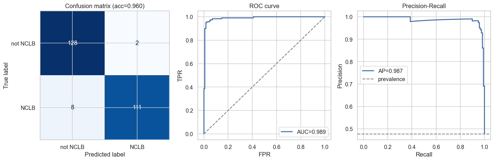
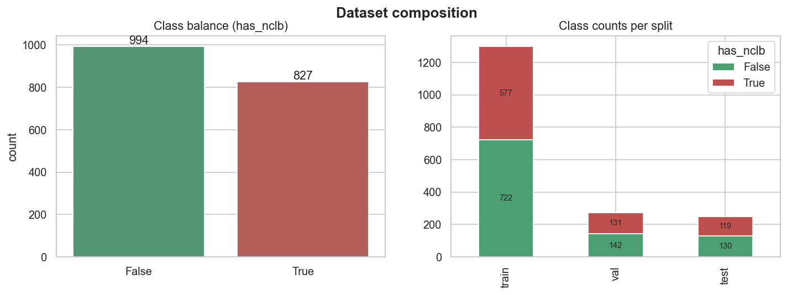
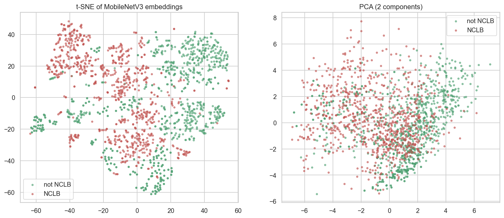

# 🌽 zim-crop-disease-detector

Deep-learning detection of **Northern Corn Leaf Blight (NCLB)** in maize leaf photographs collected in Zimbabwe — distinguishing NCLB from **other maize diseases**. The pipeline runs intensive EDA, trains a fine-tuned CNN alongside classical baselines, and evaluates everything on a held-out test set with interpretability and error analysis.

> **Headline result:** a fine-tuned MobileNetV3 correctly categorises **96.0%** of held-out leaves (239 / 249) as NCLB / non-NCLB, at **0.989 ROC-AUC**.

Full write-up: **[SUMMARY.md](SUMMARY.md)** · Notebook: **[crop_disease_classification.ipynb](crop_disease_classification.ipynb)**

---

## Results at a glance

| Model | Test ROC-AUC | Test accuracy | Balanced acc |
|---|---|---|---|
| **Fine-tuned MobileNetV3 (CNN)** | 0.989 | **96.0%** | 0.959 |
| RBF-SVM on frozen embeddings | 0.998 | — | — |
| Majority-class baseline | 0.50 | 54.6% | 0.50 |

*Held-out test set: 249 images, scored as one categorisation task. Confusion matrix: TN 128 · FP 2 · FN 8 · TP 111.*

**Accuracy by source collection** (diagnostic view): Other diseases 98.5% · NCLB-original 93.3%.



---

## Dataset

| | |
|---|---|
| Total images | **1,821** (224×224) |
| NCLB / not-NCLB | 827 / 994 |
| Train / Val / Test | 1,299 / 273 / 249 |

The negatives are **other maize diseases** (no healthy leaves), so the model must learn NCLB's specific lesions and tell them from *other* disease symptoms — not merely separate sick from healthy.



---

## How the model sees the data

ImageNet embeddings already separate the two classes cleanly — visible in the 2-D projection — which is why even classical models score near-ceiling.



**Grad-CAM** (generated in the notebook) highlights what drives an NCLB prediction. Attention overlaps lesion regions but is somewhat diffuse — a cue that cross-field validation is the real test (see [SUMMARY.md](SUMMARY.md#6-limitations--next-steps)).

---

## Method

1. **EDA** — class balance, sample galleries, interpretable colour/texture descriptors, correlations, class-average images.
2. **Frozen embeddings + classical models** — MobileNetV3-Small features → Logistic Regression / SVM / Random Forest / HistGB.
3. **Fine-tuned CNN** — partial fine-tuning of MobileNetV3-Small with augmentation, class weighting, AdamW + cosine schedule, early stopping.
4. **Evaluation & interpretability** — ROC/PR curves, confusion matrix, Grad-CAM, error gallery.

Every score is reported on a fixed `split` so the model is never evaluated on data it trained on.

---

## Run it

```bash
# deps: torch torchvision scikit-learn pandas matplotlib seaborn scipy pillow nbconvert
python build_nb.py
python -m nbconvert --to notebook --execute --inplace \
    --ExecutePreprocessor.timeout=-1 crop_disease_classification.ipynb
```

Figures land in `outputs/figures/`, metrics in `outputs/metrics.json`, the trained model in `outputs/models/`.

## Repository layout

```
crop_disease_classification.ipynb   # full EDA + modelling notebook
build_nb.py                         # regenerates the notebook
labels.csv                          # filename, has_nclb, label, split
SUMMARY.md                          # detailed write-up
outputs/figures/                    # all generated graphs (tracked)
dataset/                            # images (git-ignored)
```

---

## Limitations

Even on this harder NCLB-vs-other-disease task the in-dataset AUC stays ≈ 0.99, so the meaningful open question is **generalisation to new fields/seasons**; the strongest remaining stress tests are recognised NCLB look-alikes (gray leaf spot, Goss's wilt). See [SUMMARY.md](SUMMARY.md#6-limitations--next-steps) for the full discussion and next steps.
