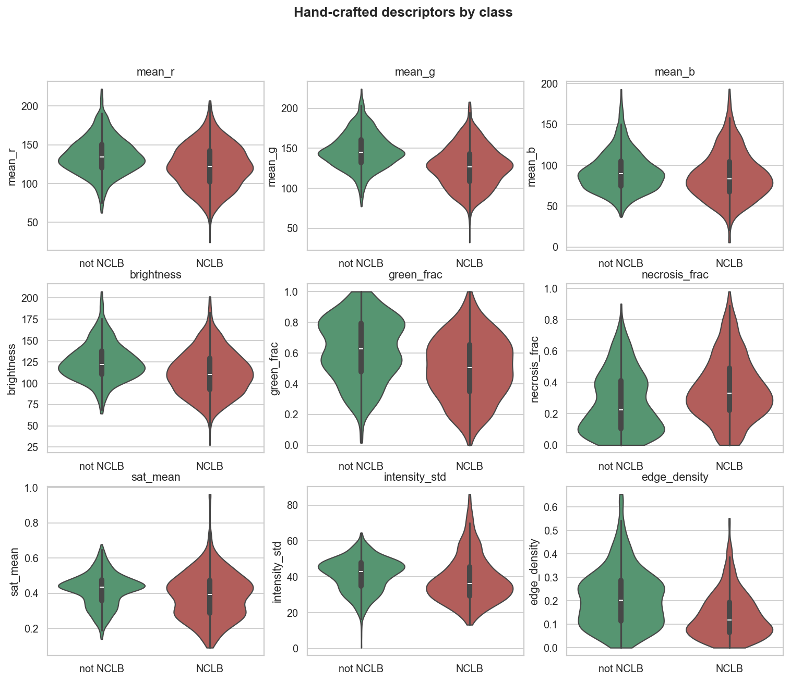
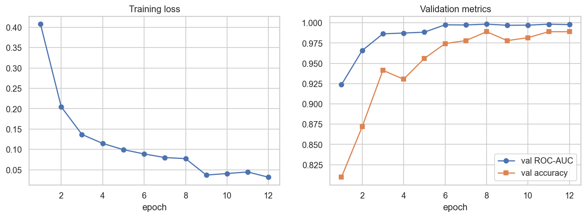
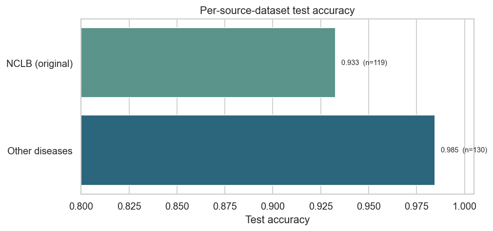
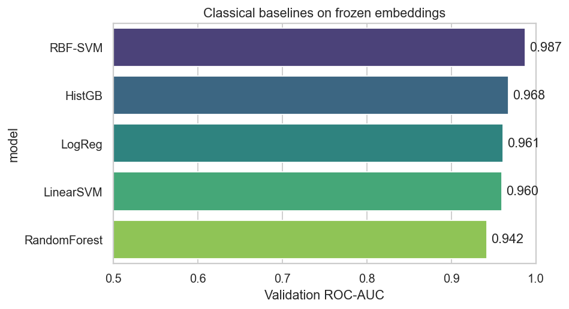

# Maize NCLB Detection — Project Summary

A deep-learning pipeline that decides whether a maize leaf photograph shows **Northern Corn Leaf Blight (NCLB)** or not. This document summarises the data, method, results and limitations. All figures referenced here live in `outputs/figures/` and are produced by [`crop_disease_classification.ipynb`](crop_disease_classification.ipynb).

---

## 1. Dataset

Field photographs of maize leaves collected in Zimbabwe, labelled in `labels.csv`. Every image is centre-squared and resized to **224×224 px**.

| | |
|---|---|
| Total images | **1,821** |
| NCLB (positive) | 827 (45.4%) |
| Not NCLB (other maize diseases) | 994 (54.6%) |
| Train / Val / Test | 1,299 / 273 / 249 |
| Majority-class baseline accuracy | 54.6% |

`labels.csv` columns: `filename`, `has_nclb`, `label` (0/1), `split`. The `split` column is fixed so every reported metric is on data the model never trained on.


This is the demanding version of the problem: the "not NCLB" class contains **other maize diseases** (no healthy leaves at all). The model must therefore learn NCLB's specific tan/grey cigar-shaped lesions and tell them apart from *other* disease symptoms — not merely separate diseased from healthy tissue.

---

## 2. Method

The pipeline runs two complementary modelling routes and compares them on the same held-out test set.

**Route A — Frozen embeddings + classical models.** Every image is passed once through an ImageNet-pretrained **MobileNetV3-Small** (classifier removed) to obtain a 576-D embedding. Classical classifiers (Logistic Regression, Linear/RBF SVM, Random Forest, HistGradientBoosting) are trained on these embeddings; the best is chosen by validation ROC-AUC and evaluated once on test.

**Route B — Fine-tuned CNN (headline model).** The same MobileNetV3-Small backbone with its early blocks frozen, the last blocks plus a fresh 2-class head fine-tuned end-to-end. Training uses:
- **Augmentation:** random flips, ±20° rotation, colour jitter (lesions are orientation-invariant).
- **Class weighting:** inverse-frequency weighted cross-entropy to handle the (mild) class imbalance.
- **AdamW + cosine annealing**, with **early stopping** on validation ROC-AUC.

---

## 3. Exploratory data analysis

* **Class separability is high.** Both the 2-D embedding projection (t-SNE/PCA) and the hand-crafted colour descriptors (green fraction, necrosis/tan fraction) show the two classes occupying largely distinct regions before any training — NCLB leaves carry distinctive tan, cigar-shaped necrotic lesions that the other-disease leaves do not.
* **Interpretable signal exists in colour alone**, which is why the classical baselines (below) already score near-ceiling.




---

## 4. Results (held-out test set, 249 images)

### Fine-tuned CNN — headline model

Evaluated as a single categorisation task — *was each leaf placed in the right class?* — across both classes together:

| Metric | Value |
|---|---|
| Accuracy | **96.0%** (239 / 249) |
| Balanced accuracy | 0.959 |
| Macro-F1 | 0.960 |
| ROC-AUC | 0.989 |
| PR-AUC | 0.987 |
| Confusion | TN 128 · FP 2 · FN 8 · TP 111 |

Of the 249 test images, **239 were categorised correctly**. The 10 errors are 8 NCLB leaves placed in non-NCLB and 2 other-disease leaves placed in NCLB — i.e. the residual difficulty is *missing* blight, not over-calling it.




The CNN early-stopped after **12 epochs**.

#### Per-source-dataset accuracy (diagnostic view)

The same overall predictions, broken down by which source collection each test image came from:

| Source dataset | Test images | Accuracy |
|---|---|---|
| Other diseases | 130 | 98.5% |
| NCLB (original) | 119 | 93.3% |



The harder side is NCLB itself (8 of 119 missed); other-disease leaves are rarely mistaken for blight (2 of 130).

### Classical baselines on frozen embeddings

| Model | Val ROC-AUC |
|---|---|
| **RBF-SVM** (selected) | **0.987** |
| HistGradientBoosting | 0.968 |
| Logistic Regression | 0.962 |
| Linear SVM | 0.960 |
| Random Forest | 0.942 |

The selected RBF-SVM reached **test ROC-AUC 0.998** — ImageNet features alone, with no fine-tuning, already separate the two classes very well.



---

## 5. Interpretability & error analysis

**Grad-CAM** (generated in the notebook) shows where the network looks when predicting NCLB. The attention is **diffuse**: it frequently overlaps leaf and lesion regions, but in several examples also activates on background. This is a flag, not a verdict — it suggests the model may lean partly on contextual cues, and is the main reason a *cross-field* test (see Limitations) matters.

**Errors.** The mistakes (8 false negatives, 2 false positives) are mostly faint/edge-case blight missed, plus a couple of other-disease leaves flagged as NCLB.

> Note: the Grad-CAM and error-gallery figures contain plant photographs and are intentionally **not** committed to the repository. Run the notebook to regenerate them locally in `outputs/figures/`.

---

## 6. Limitations & next steps

* **Strong in-dataset performance on a genuinely harder task.** Discriminating NCLB from *other maize diseases* (no healthy leaves) still yields ~0.99 AUC and 96% accuracy; the honest open question remains **generalisation to a new field/season**, not in-dataset accuracy.
* **Possible background confound.** The diffuse Grad-CAM means the model might use scene context. A clean test is an **independently photographed hold-out set**.
* **The other-disease negatives may still under-represent the hardest cases.** The strongest stress tests are recognised **NCLB look-alikes** (gray leaf spot, Goss's wilt, southern leaf blight) at varied severities.
* **Future work:** collect more diverse original photos; expand to **multi-class** disease classification; try EfficientNet/ConvNeXt backbones with test-time augmentation; calibrate the decision threshold to the agronomic cost of a missed infection.

---

## 7. Reproducing

```bash
# dependencies: torch, torchvision, scikit-learn, pandas, matplotlib, seaborn, scipy, pillow
python build_nb.py                      # (re)generate the notebook
python -m nbconvert --to notebook --execute --inplace \
    --ExecutePreprocessor.timeout=-1 crop_disease_classification.ipynb
```

Outputs: figures in `outputs/figures/`, metrics in `outputs/metrics.json`, trained model in `outputs/models/`. The image data (`dataset/`) and model artifacts are git-ignored; the notebook regenerates all results from them.
